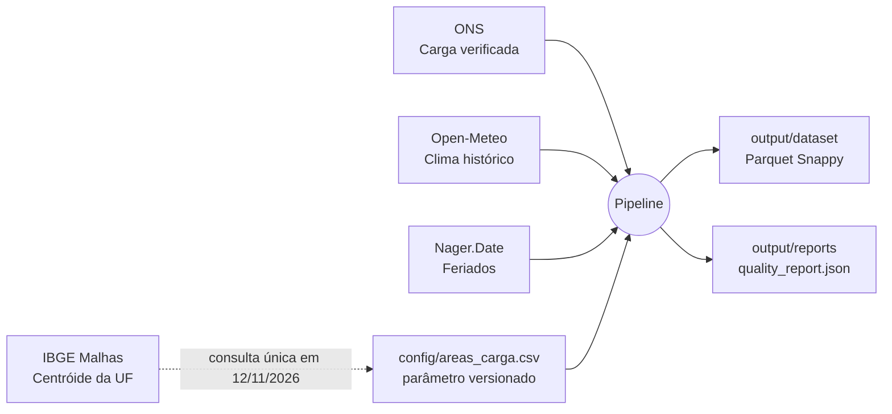
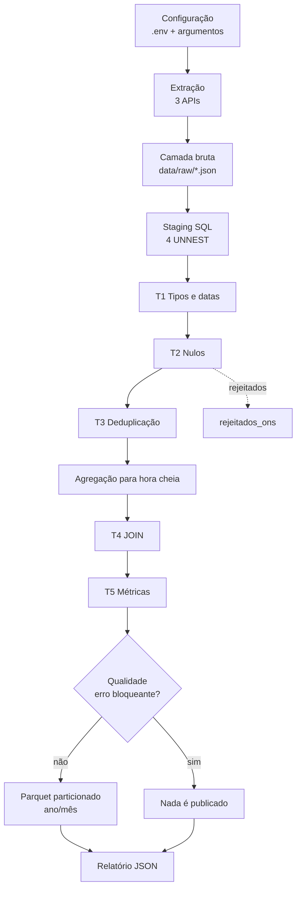
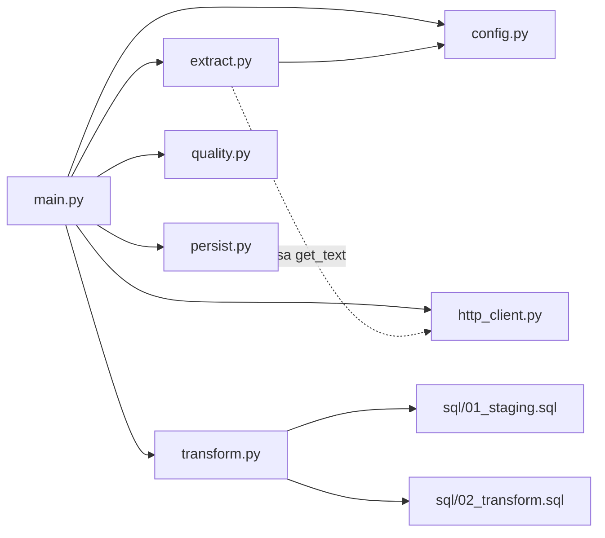
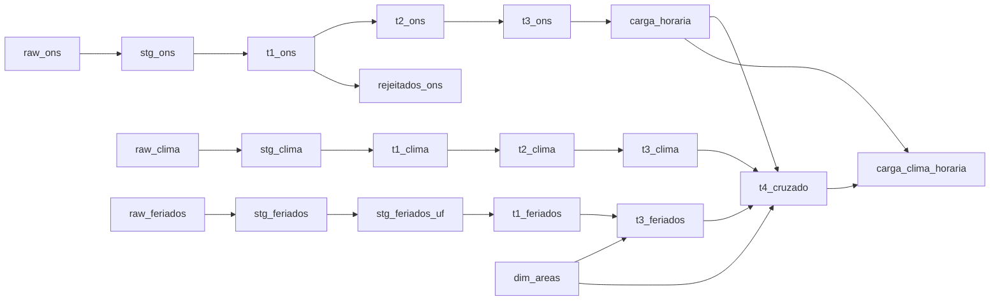
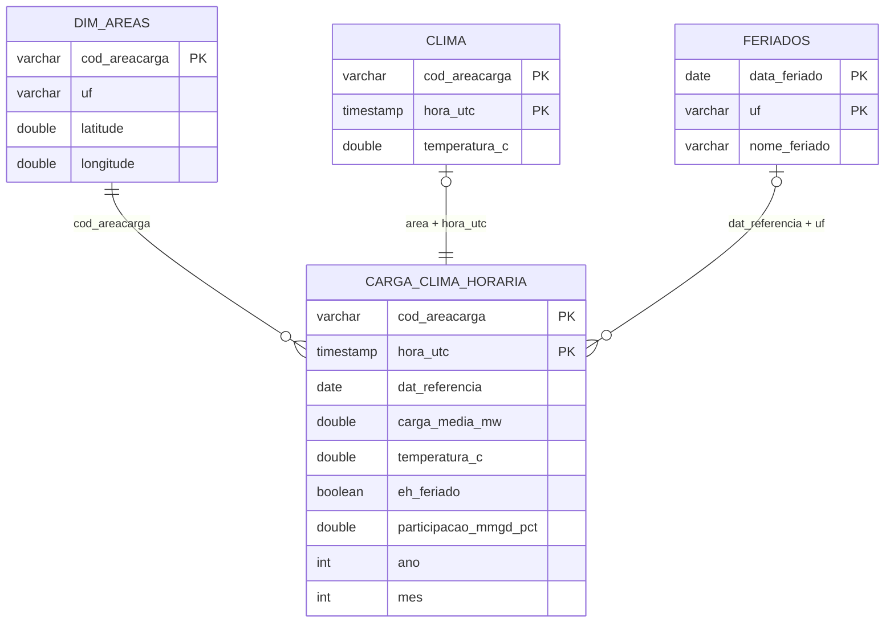
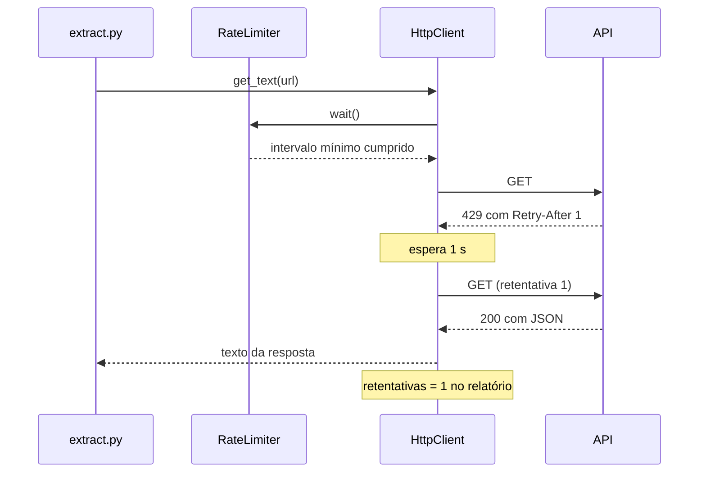
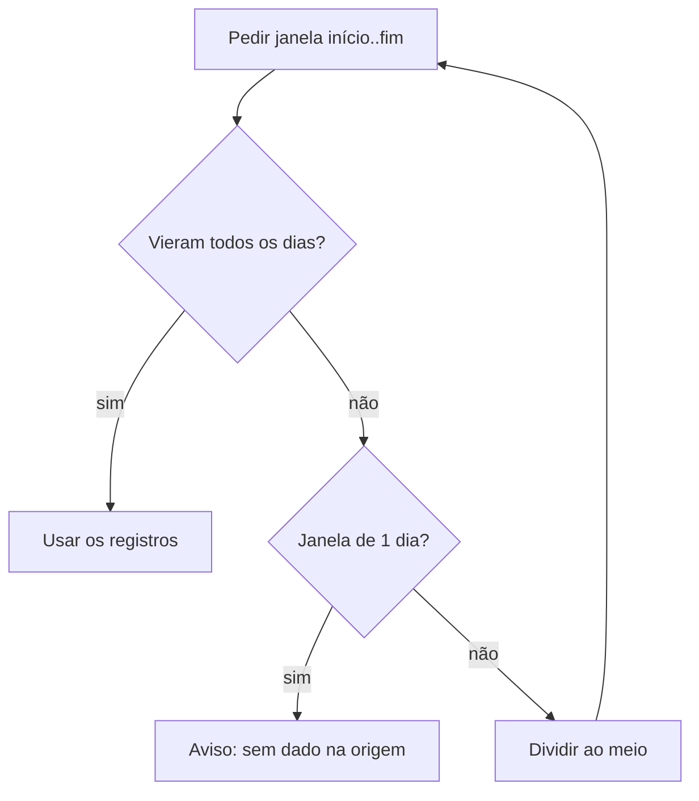
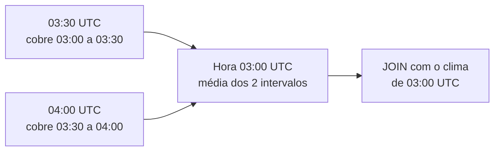
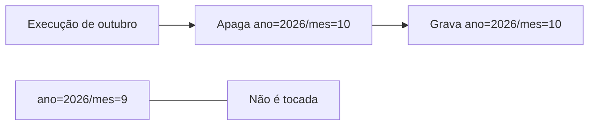

# Diagramas

Versão 1.0 · 12/11/2026

Os diagramas estão em Mermaid. No VS Code, instale a extensão recomendada
"Markdown Preview Mermaid Support" e abra a pré-visualização (Ctrl+Shift+V). O GitHub
desenha os blocos automaticamente.

## 1. Contexto

Quem fornece dados ao pipeline e o que ele entrega.

## 2. Fluxo do pipeline

As etapas, da extração à publicação, com o ponto em que a qualidade pode bloquear.

## 3. Módulos

Dependências entre os módulos Python e os arquivos SQL.

## 4. Linhagem das tabelas

De qual tabela cada tabela é derivada, dentro do DuckDB.

## 5. Modelo do dataset final

A tabela entregue e as tabelas de apoio que a formam.

## 6. Chamada HTTP com falha transitória

O que acontece quando a API responde 429 e depois se recupera.

## 7. Resposta incompleta do ONS

Como a janela é dividida quando faltam dias na resposta.

## 8. Hora cheia a partir da meia hora

Por que os instantes 03:30 e 04:00 formam a hora 03:00.

## 9. Reprocessamento

O que acontece com as partições ao rodar de novo.

